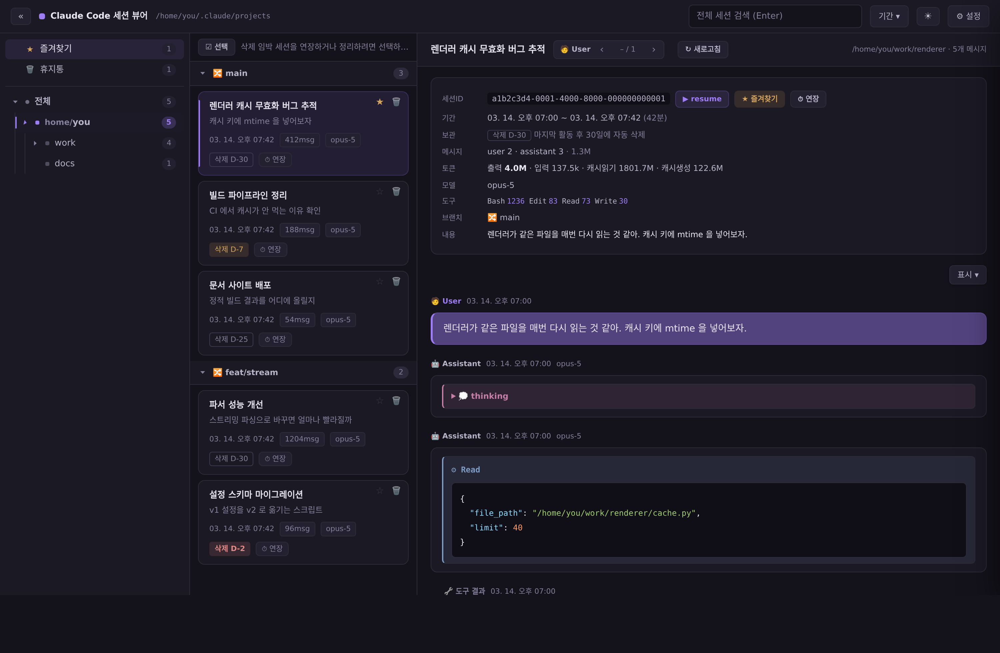
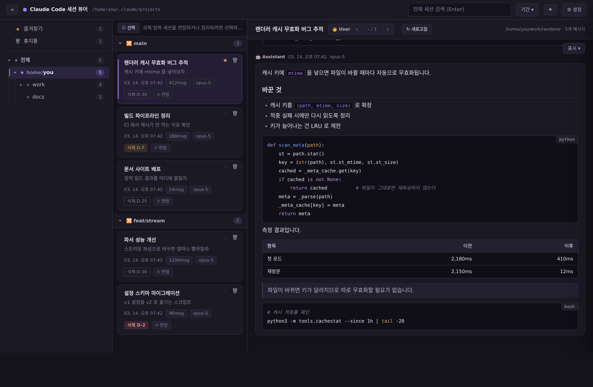
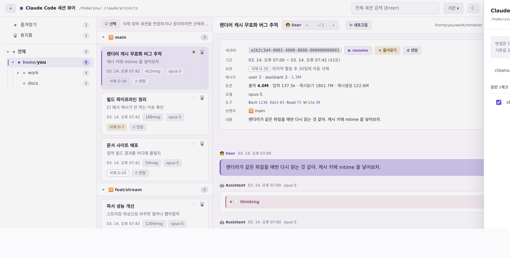
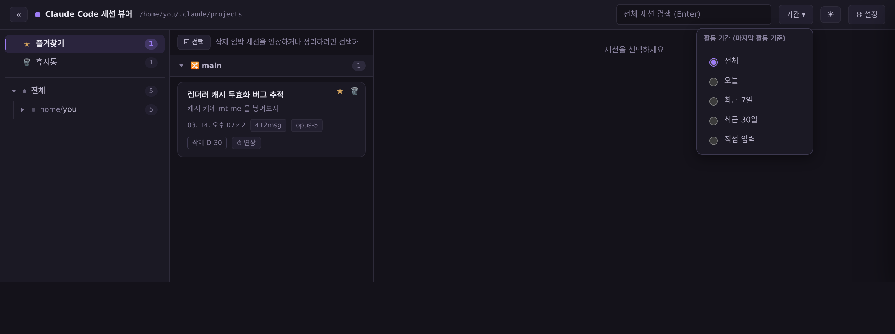

# cc-explorer — Claude Code 세션 뷰어

로컬에 쌓인 Claude Code 세션 기록(`~/.claude/projects/**/*.jsonl`)을 디렉토리 위계로 탐색하고,
대화 타임라인을 다시 읽고 · 검색하고 · 정리하는 로컬 웹앱.

- 서버는 파이썬 **표준 라이브러리만** 사용 — 설치할 패키지 없음
- `127.0.0.1` 에만 바인드, **외부 네트워크 호출 없음**
  (코드 하이라이팅용 highlight.js 는 `vendor/` 에 번들로 들어 있다)
- **대화 기록 내용은 수정하지 않는다** — 쓰기는 삭제 연장 · 휴지통 · 설정 편집뿐
- macOS · Linux · Windows 동작

---

## 기능

### 1. 세션 탐색



- **디렉토리 트리** — 세션이 실행된 실제 `cwd` 로 위계를 만든다. 맨 위 **전체**를 고르면
  모든 세션이, 아래 디렉토리를 고르면 그 아래만 나온다.
- **즐겨찾기 ★** — 자주 돌아가는 세션에 별을 달면 트리 맨 위에 모인다.
  세션 카드 우상단이나 타임라인 헤더에서 토글한다. 켜 둔 게 있으면 앱을 열 때 여기서 시작한다.
- **세션 목록** — 최근 활동순, git 브랜치(`🔀`)별 그룹. 제목 · 시각 · 메시지 수 · 모델 · `삭제 D-N` 배지.
- **분기 위계** — `/branch` 로 갈라진 세션을 부모 밑에 들여쓰기로 붙이고 `⑂ 분기` 태그를 단다.
  부모가 다른 브랜치·폴더에 있으면 태그에 마우스를 올려 원본 세션 제목을 확인한다.
- **전체 세션 검색** — 모든 세션 본문을 훑어 매칭 세션과 스니펫을 보여준다.
- **▶ resume** — `cd '<cwd>' && claude -r '<세션ID>'` 를 클립보드에 복사해 그 세션을 이어간다.
- **« 사이드바 접기** — 트리를 접어 타임라인을 넓게 쓴다.

### 2. 타임라인



- **시간순**으로 읽고, 세션을 열면 **맨 아래(최신)로 자동 이동**한다.
- **마크다운 렌더** — assistant 본문의 제목 · 목록 · 표 · 인용 · 링크를 그대로 그린다.
  사용자 입력은 친 그대로 둔다(`# 주석` 이 제목으로 둔갑하지 않게).
- **코드 하이라이팅** — 언어 태그가 있으면 그 언어로, 없으면 흔한 언어 범위에서 추정한다.
  라이트 모드에서도 코드 블록은 어두운 면을 써서 색이 선명하다.
- **🧑 User ‹ › 탐색** — 사용자 발화 사이만 건너뛴다. 긴 세션에서 "내가 뭘 시켰는지" 훑을 때.
  본문 검색은 브라우저의 `Ctrl+F` 가 더 낫다.
- **↻ 새로고침** — 지금 열린 세션만 파일에서 다시 읽는다. 다른 터미널에서 진행 중인
  세션을 따라볼 때. 늘어난 메시지 수를 알려준다.
- **표시 ▾** — 타임라인에 그릴 유형을 고른다:
  🧑 User · 🤖 Assistant · 🔧 도구 결과 · 📎 주입 컨텍스트 · 💭 thinking · ⚙ 도구 호출.
  어떤 메시지의 내용이 전부 가려지면 말풍선과 머리글까지 함께 감춘다.

> Claude Code 는 사람이 친 입력이 아닌 것(백그라운드 작업 알림, 슬래시 명령과 그 출력,
> 컨텍스트 압축 요약)도 `user` 로 기록한다. 이들은 🧑 User 가 아니라
> 📎 주입 컨텍스트 계열로 분류해 접어 둔다.

### 3. 보관 · 정리




Claude Code 는 시작할 때 `cleanupPeriodDays`(기본 30일)보다 오래된 세션 파일을 지운다
([문서](https://code.claude.com/docs/en/claude-directory#cleaned-up-automatically)).
따로 알려주지 않으므로, 남은 기간을 `삭제 D-N` 배지로 띄우고(3일 이하 빨강 · 7일 이하 노랑)
두 가지 방법으로 막는다.

- **⏱ 연장** — 그 세션의 시계만 리셋한다(내용은 그대로). 파일 mtime 을 현재로 갱신하는 방식이다.
- **⚙ 설정 → `cleanupPeriodDays`** — 기준 기간 자체를 늘린다(예: 30 → 180).
  모든 세션에 적용되고 배지도 즉시 새 기준으로 다시 계산된다.
  저장 전 `settings.json.bak` 백업을 남긴다.

정리는 **휴지통을 거친다**.

- **🗑 휴지통으로** — 세션 카드의 🗑 로 한 건씩, 또는 `☑ 선택` 후 여러 건을 한 번에.
  파일은 지워지지 않고 `~/.claude/.cc-explorer-trash/` 로 옮겨진다. 사이드카 디렉토리
  (`<session>/subagents/`, `<session>/tool-results/`)도 함께 간다.
- **↩ 복원 / 영구 삭제** — 트리의 **🗑 휴지통**에서. 복원하면 원래 폴더로 돌아간다.
  영구 삭제만 복구 불가다.

> 휴지통은 `projects/` **바깥**에 둔다. 안에 두면 Claude Code 와 이 뷰어 양쪽이 버린 세션을
> 살아있는 세션으로 다시 집어든다. 대신 휴지통에 있는 동안에는 Claude Code 에서 그 세션을
> 열 수 없고, 덤으로 자동 삭제도 휴지통 항목은 건드리지 못한다.

### 4. 그 밖에

- **기간 ▾** — 전체 / 오늘 / 최근 7일 / 최근 30일 / 직접 입력. 마지막 활동 기준이며
  목록 · 검색 결과 · 트리의 세션 수에 함께 적용된다.
- **☀ / ☾ 테마** — 라이트·다크 전환. 고른 적이 없으면 OS 설정을 따른다.
- 수천 메시지짜리 세션도 접기/펼치기가 멎지 않는다 — 화면 밖 메시지는
  `content-visibility` 로 레이아웃을 건너뛴다.

---

## 설치

```bash
git clone https://github.com/Noaarhk/cc-explorer.git
cd cc-explorer
python3 install.py      # Windows: python install.py
```

전역 명령어가 등록되어 어디서든 실행할 수 있다.

```bash
cc-explorer
```

`http://127.0.0.1:8765/` 가 브라우저에서 자동으로 열린다(포트가 쓰이고 있으면 자동 증가).
`--no-open` 으로 자동 열기를 끄고, `Ctrl+C` 로 종료한다.

설치 없이 바로 실행해도 된다.

```bash
python3 server.py       # Windows: python server.py
```

> 요구사항은 Python 3.8+ 와 브라우저뿐이다.
> 레포를 다른 경로로 옮기면 링크가 깨지므로 `install.py` 를 다시 실행한다.

### 코드를 고친 뒤에는

`index.html` 은 요청마다 디스크에서 새로 읽히지만 **서버는 떠 있던 프로세스가 그대로**다.
`server.py` 를 고치고 재시작을 잊으면 새 화면이 옛 서버에 말을 걸어 조용히 실패한다.
그래서 화면과 서버의 버전이 다르면 **빨간 배너**로 알려준다 — 뜨면 `Ctrl+C` 후 다시 실행하면 된다.

## 제거

```bash
python3 install.py --uninstall
```

---

## 레포 구성

| 경로 | 설명 |
|---|---|
| `server.py` | 로컬 서버 + 세션 파싱. 표준 라이브러리만 사용 |
| `index.html` | 화면 전체(스타일·스크립트 포함) |
| `vendor/` | highlight.js 번들과 라이선스. 미니파이하지 않은 소스 |
| `tools/build_hljs.py` | highlight.js 번들 재생성(언어 추가·버전 업) |
| `tools/make_screenshots.py` | README 스크린샷 생성. 데모 데이터를 쓰므로 개인 기록이 섞이지 않는다 |
